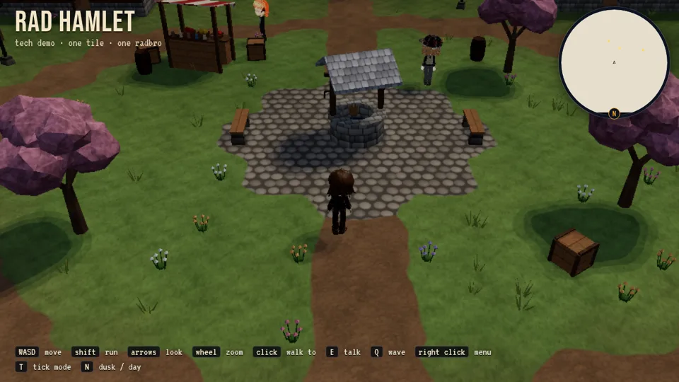
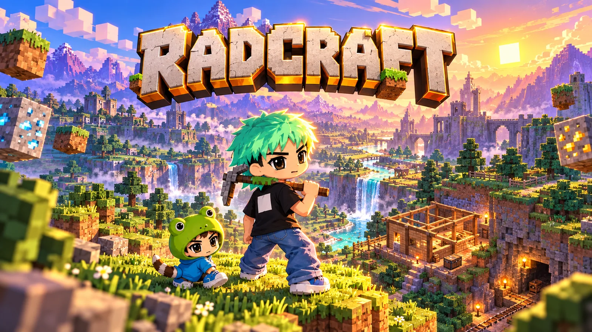
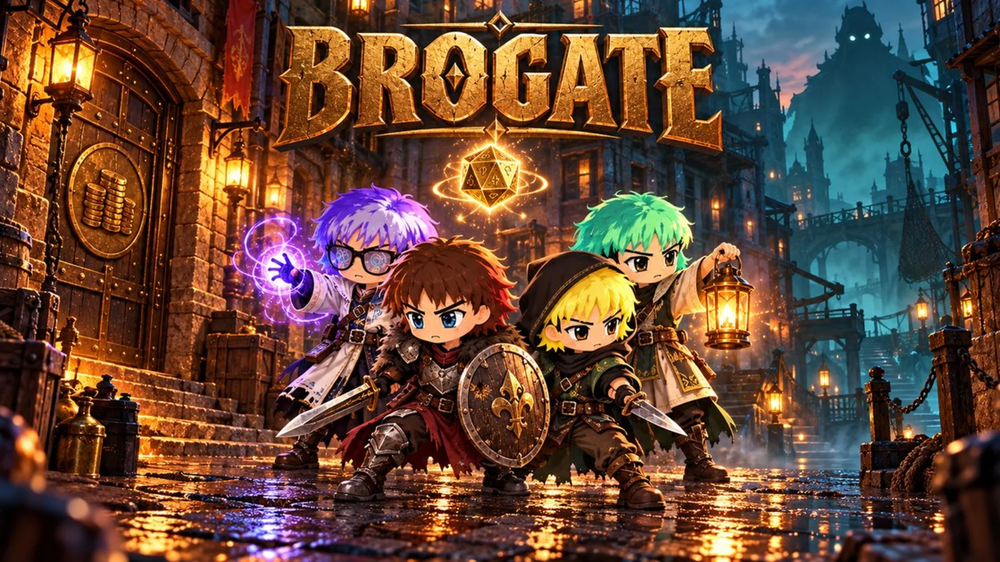
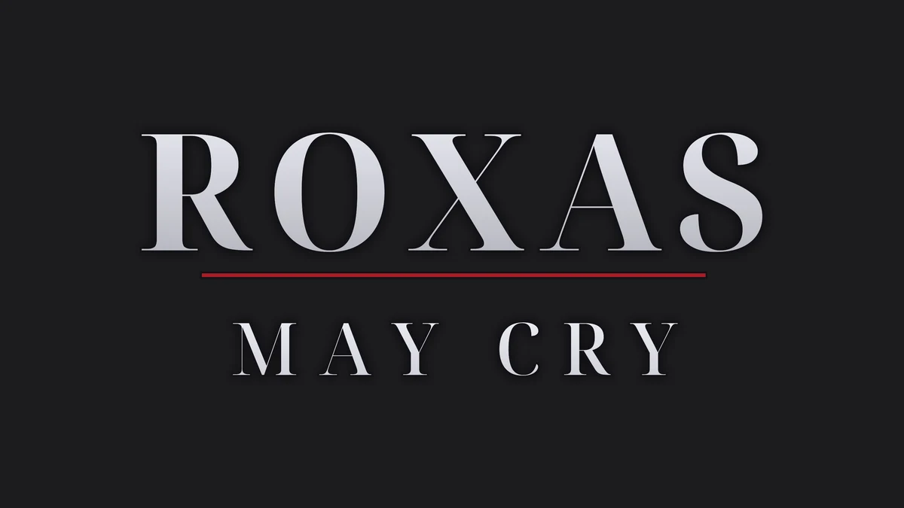
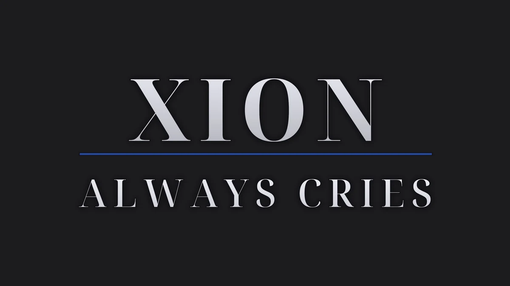

i make browser games and 3d radbros. the games are free to play and the radbros are free to use.

if you're against "vibecoding" or ai-use kindly go fuck yourself 

[vyvanse.beer](https://vyvanse.beer) · [x.com/dexedrne](https://x.com/dexedrne)

### games

all free, in the browser, keyboard or controller. every one of them is on [vyvanse.beer](https://vyvanse.beer).

<table>
<tr>
<td width="33%" valign="top">

 <b>SHITBOX</b> 
a tired 1993 four-door with a real five-speed and $25 to your name. odd jobs, a mountain pass, winters, the city up the highway. online cruising with up to ten. 
<a href="https://shitbox.vyvanse.beer">play</a>
</td>
<td width="33%" valign="top">

 <b>SPIDERTAG</b> 
web-slinger tag on the neon rooftops. tag a friend online or bots, best of three, or chase the radbro who swiped your bag. (formerly radrun) 
<a href="https://spidertag.vyvanse.beer">play</a> · <a href="https://github.com/dexedrne/radrun">source</a>
</td>
<td width="33%" valign="top">

 <b>SALOON</b> 
hold'em with the crew at a lamp-lit table in a western saloon. solo against all seven or online with friends. play chips only. 
<a href="https://saloon.cards">play</a>
</td>
</tr>
<tr>
<td width="33%" valign="top">

 <b>RadPayne</b> 
bullet-time noir shooter with the radbros, told in rhyming comic panels. the harder retardio cut is <a href="https://retardiopayne.vyvanse.beer">RetardioPayne</a>. 
<a href="https://radpayne.vyvanse.beer">play</a> · <a href="https://github.com/dexedrne/radpayne">source</a>
</td>
<td width="33%" valign="top">

 <b>RadZombies</b> 
radbros vs the dead. board up the windows, buy doors and guns, last the rounds. solo, bots, four online or split screen. retardios only: <a href="https://zombietardio.vyvanse.beer">ZombieTardio</a>. 
<a href="https://radzombies.vyvanse.beer">play (early)</a>
</td>
<td width="33%" valign="top">

 <b>RADTAP</b> 
rhythm game with the crew playing on stage. eight original songs, four lanes or seven, or two thumbs on a phone. 
<a href="https://radtap.vyvanse.beer">play</a>
</td>
</tr>
<tr>
<td width="33%" valign="top">

 <b>RADBRAWL</b> 
platform fighter on a wet neon rooftop, up to four on one screen. the one-on-one anime cut is <a href="https://radfighter.vyvanse.beer">RAD FIGHTER</a>. 
<a href="https://radbrawl.vyvanse.beer">play</a>
</td>
<td width="33%" valign="top">

 <b>RBGO</b> 
radbros vs radbros, plant the bomb or defuse it in a desert bazaar. 2v2 online or up to five a side with bots. 
<a href="https://rbgo.vyvanse.beer">play (early)</a>
</td>
<td width="33%" valign="top">

 <b>RadOps</b> 
team deathmatch in a sun-bleached cul-de-sac, 4v4 or 5v5 online, bots fill the empty seats. first to 50. 
<a href="https://radops.vyvanse.beer">play (early)</a>
</td>
</tr>
<tr>
<td width="33%" valign="top">

 <b>RADBONK</b> 
survivor-like in a dark forest and a desert past the boss portal. auto-fire, pick upgrades, outlast the waves, unlock feats and a camp tree between runs. 
<a href="https://radbonk.vyvanse.beer">play</a>
</td>
<td width="33%" valign="top">

 <b>RadQuest</b> 
a little radbro village at dusk to walk around in: a well, a market, benches, villagers. tech demo, more on the way. 
<a href="https://radquest.vyvanse.beer">play (demo)</a>
</td>
<td width="33%" valign="top">

 <b>RADCRAFT</b> 
a voxel sandbox with the radbros and radcats. dig, build, farm, craft four tiers of tools and armour, find buried vaults, tame a radcat, and get through the night. 
<a href="https://radcraft.vyvanse.beer">play (early)</a>
</td>
</tr>
<tr>
<td width="33%" valign="top">

 <b>BROGATE</b> 
turn-based party rpg with a radbro squad in tallow, a river city of candles and paperwork. three broke people stuck outside a gate that has stopped opening. 
<a href="https://brogate.vyvanse.beer">play (early)</a>
</td>
<td width="33%" valign="top">
</td>
<td width="33%" valign="top">
</td>
</tr>
</table>

spidertag and radpayne run on [react-three-game](https://prnth.com/react-three-game/) by prnth. the miladys in them (and the villagers coming to radquest, remilio included) are [pockit](https://github.com/prnthh/Pockit) miladys by prnth, used with his permission.

### kingdom hearts mods

free, for everyone. no patreon, no early-access tiers, no paywalled builds, no gatekeeping.

<table>
<tr>
<td width="50%" valign="top">

 <b>Roxas May Cry</b> 
kingdom hearts ii final mix as roxas, played all the way to the end: the late game, the world that never was and the ending finished and fixed, plus the ps2 version's extra fights and rules brought back. four modes (critical, less than nothing, xion knows best, xion always cries), an in-game settings menu with cheats, and switch between roxas and xion whenever you want, plus the postgame. 
<a href="https://github.com/dexedrne/roxas-may-cry">build it from your own game</a>
</td>
<td width="50%" valign="top">

 <b>Xion Always Cries</b> 
the xion side: xion playable in roxas's place, on his skeleton and moves, with her own hud faces, menu names and battle voice, hooded or not. two modes of her own: xion knows best (critical rules) and xion always cries (less than nothing rules). an hd xion built from your own copy of kingdom hearts iii is next. 
coming soon
</td>
</tr>
</table>

pc, installed with the [openkh](https://github.com/OpenKH/OpenKh) mods manager. no game files get passed around: the release is a builder that makes the mod from the copy of the game you own.

out now, all public:

- [Roxas May Cry](https://github.com/dexedrne/roxas-may-cry): the Roxas campaign played to the end, built on your PC from your own game files
- [NMC Fixed](https://github.com/dexedrne/NMC-Fixed): the original Nobody May Cry mod with every fix and addition, for the Steam version through OpenKH
- [Nobody May Cry: Recompiled](https://github.com/dexedrne/nmc-recomp): the game and the mod recompiled to run natively on iPhone, macOS and Linux
- [nmc-decomposed](https://github.com/dexedrne/nmc-decomposed): the mod as readable patches, rebuilt from your own copy of the game
- [kh2fm-save-converter](https://github.com/dexedrne/kh2fm-save-converter): bring a PS2 (PCSX2) Final Mix save into the Steam version

in progress:

- [358/2 Days on iPhone](https://github.com/dexedrne/khdays-port/tree/ios) (work in progress): the native Days port brought to iPhone and iPad, dual screens, touch and controllers

### the crew in 3d, free to use

<table>
<tr>
<td align="center"> #4764</td>
<td align="center"> #652</td>
<td align="center"> #3704</td>
<td align="center"> #3710</td>
<td align="center"> #723</td>
</tr>
<tr>
<td align="center"> #2564</td>
<td align="center"> retardio #555</td>
<td align="center"> retardio #85</td>
<td align="center"> retardio #268</td>
<td></td>
</tr>
</table>

six radbros and three retardios, rigged and animated (the radbros used with the radbro webring dev's permission). put them in your game, render them, remix them, sell them. for radbros, miladies, anyone.
get them one click each at [vyvanse.beer](https://vyvanse.beer/#crew), [all nine in one zip](https://github.com/dexedrne/vyvanse.beer/releases/download/radbros-3d/crew-3d-all-nine.zip) (185 MB), or from [radbros-3d](https://github.com/dexedrne/radbros-3d).

### sites i built

my own [solscape](https://play.solscape.fun), an open-source, copyright-free rev254 private server on solana, and sites for other people's projects:

<table>
<tr>
<td align="center" valign="top"> solscape</td>
<td align="center" valign="top"> bitcorn</td>
<td align="center" valign="top"> bulk</td>
<td align="center" valign="top"> bulkagachi</td>
<td align="center" valign="top"> sanic</td>
<td align="center" valign="top"> hog rider 3d</td>
<td align="center" valign="top"> sassy</td>
</tr>
</table>

### use my stuff

the 3d crew is under the [viral public license](https://viralpubliclicense.org/VPL.txt), same as milady and remilio: use them for anything, just keep the license attached. if you use my radbros, please credit me on x: [@dexedrne](https://x.com/dexedrne).

### contact

dm me on x: [@dexedrne](https://x.com/dexedrne)
